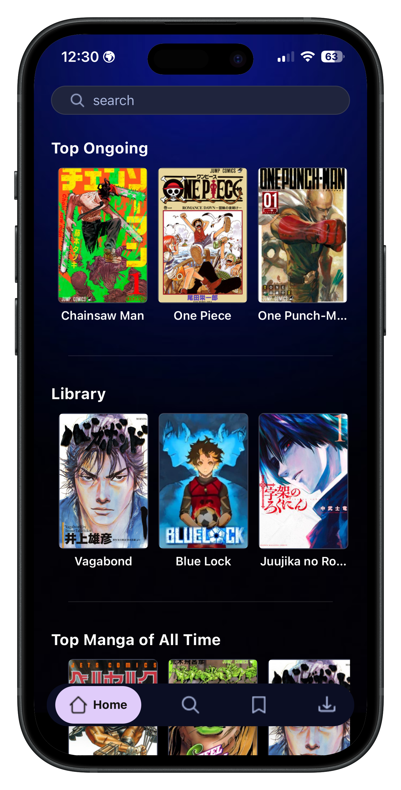
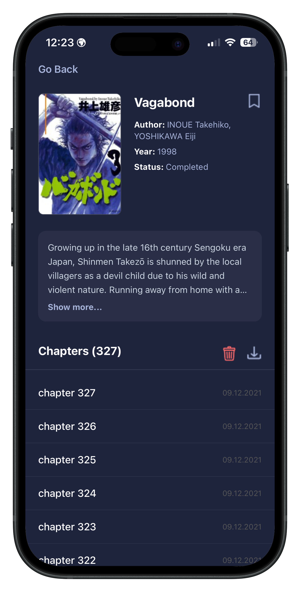
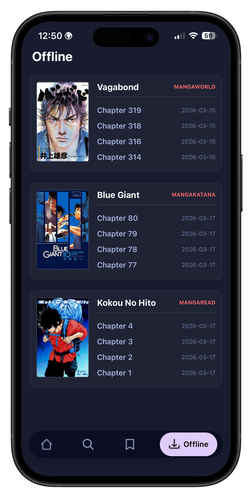

# MangaBase

MangaBase è un'applicazione React Native creata con Expo, progettata per tracciare e leggere manga da varie fonti online. Funziona come un browser specializzato, utilizzando fetching personalizzati per aggregare i contenuti, gestire una libreria personale e consentire la lettura offline.

## Features

* **Multi-Source Architecture:** Architettura modulare progettata per supportare molteplici moduli di fornitura contenuti.
* **Offline Reading:** Scarica i capitoli completi in locale sul dispositivo utilizzando il file system per la lettura senza connessione internet.
* **Library Management:** Salva i tuoi manga preferiti e traccia automaticamente i progressi di lettura e gli ultimi capitoli letti.
* **Discover Section:** Integrazione con l'API AniList per recuperare e mostrare i manga più popolari del momento e di tutti i tempi.
* **Custom Reader:** Lettore di immagini integrato con funzionalità di ridimensionamento dinamico delle immagini e pre-fetching per uno scorrimento fluido.

## Project Structure

* `/src/api/` - Contiene il SourceManager, il DownloadManager e un file blueprint `sourceTemplate.md` che spiega la struttura richiesta per implementare i moduli di contenuto personalizzati
* `/src/app/` - Schermate di Expo Router (Tabs, Reader, Details, Terms of Service).
* `/src/components/` - Componenti UI riutilizzabili come MangaCard e SearchBar.
* `/src/errors/` - Classi di errore personalizzate e UI per la gestione globale degli errori.
* `/assets/` - Asset statici, icone dell'app e splash screen.

## Screenshots

  
  
  

##  Guida all'Installazione

### Per Android (APK)
1. Vai alla sezione **Releases** di questa repository e scarica l'ultima versione del file con estensione `.apk`.
2. Tocca il file scaricato per avviarlo. Se è la prima volta che installi un'app da fonti esterne, il telefono potrebbe chiederti di autorizzare l'installazione da origini sconosciute.
3. Attendi il completamento dell'installazione e apri l'app.
4. *Nota:* Se possiedi già una versione precedente di MangaBase installata, puoi installare il nuovo APK direttamente sopra la versione esistente: l'app si aggiornerà mantenendo intatti tutti i tuoi dati, la libreria e i capitoli scaricati.

### Per iOS (IPA)
1. Vai alla sezione **Releases** di questa repository e scarica l'ultima versione del file con estensione `.ipa` dal pacchetto degli asset.
2. Per installare un file `.ipa` non firmato ufficialmente da App Store, è necessario utilizzare uno strumento di sideloading gratuito come **AltStore** o **SideStore**.
3. Apri AltStore o SideStore sul tuo iPhone, vai nella scheda **My Apps** (Le mie app), tocca l'icona **`+`** in alto e seleziona il file `.ipa` appena scaricato.
4. Attendi che il processo di firma e installazione sia completato. *(Ricordati di mantenere attiva la VPN di SideStore e di aggiornare l'app ogni 7 giorni)*.
5. *Nota:* Se hai già una versione precedente dell'app sul telefono, installando il nuovo `.ipa` tramite SideStore sopra a quella vecchia, l'applicazione si aggiornerà preservando interamente i tuoi dati e i tuoi progressi.

### Installazione e Configurazione di SideStore (Guida rapida completamente gratuita)

Per installare SideStore su iOS, puoi seguire questi passaggi essenziali (la guida completa e dettagliata si trova sul [sito ufficiale di SideStore](https://docs.sidestore.io/docs/installation/)):

1. **Requisiti preliminari**: Assicurati di avere un computer (Windows, macOS o Linux), di installare l'applicazione **Iloader** sul computer e di avere installato **LocalDevVPN** sul tuo iPhone.
2. **Collegamento**: Collega il tuo iPhone al computer tramite cavo e, se richiesto, autorizza la connessione attendendo il dispositivo.
3. **Installazione iniziale**: Tramite Iloader sul computer, installa SideStore sul tuo iPhone inserendo il tuo ID Apple e la password.
4. **Attipazione della VPN**: Prima di aprire SideStore sul telefono per la prima volta, attiva la connessione VPN nell'app LocalDevVPN.
5. **Utilizzo**: Apri SideStore, vai nella sezione *My Apps*, tocca l'icona `+` per selezionare il file `.ipa` di MangaBase e avvia l'installazione. Ricordati di aggiornare le app ogni 7 giorni per mantenerle attive. La VPN deve rimanere attiva solo durante l'installazione e durante gli aggiornamenti settimanali (pochi secondi)

## Limitazione di Responsabilità (Disclaimer)
Questa applicazione è un browser web specializzato. Non ospita, memorizza o distribuisce alcun media o immagine mostrata al suo interno. Tutti i contenuti vengono recuperati dinamicamente da siti web di terze parti pubblicamente disponibili su internet. 

Tutti i marchi appartengono ai rispettivi proprietari e creatori. Questo progetto è stato creato strettamente a scopo educativo e personale.