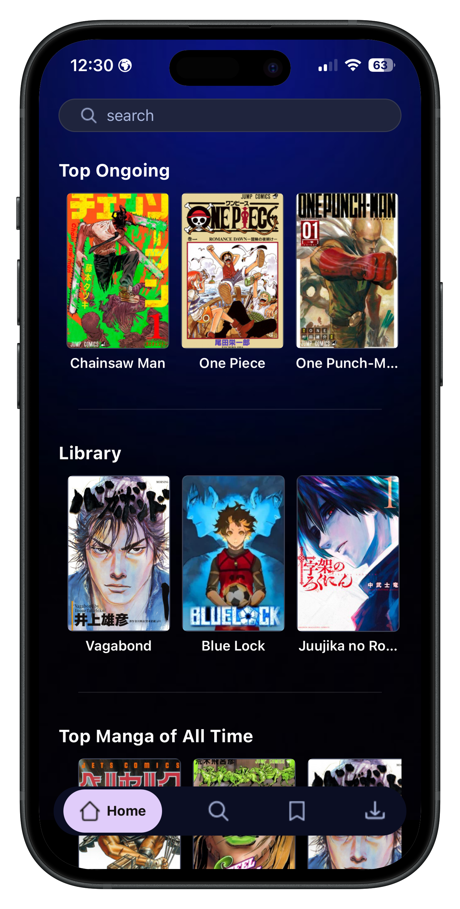
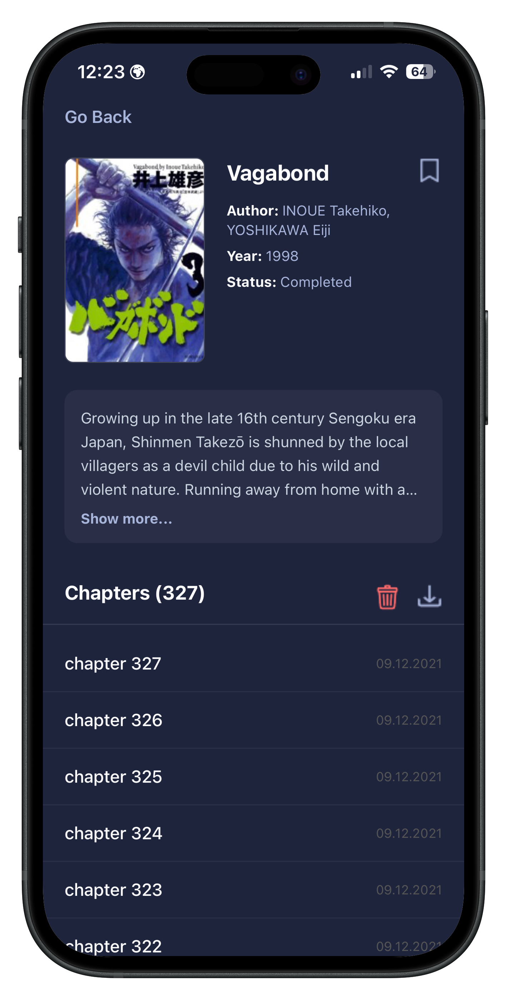

# MangaBase

MangaBase is a React Native application built with Expo designed for tracking and reading manga from various online sources. It acts as a specialized browser, utilizing custom web scrapers to aggregate content, manage a personal library, and allow offline reading.

## Features

* **Multi-Source Scraping:** Modular architecture supporting multiple scanlation websites.
* **Offline Reading:** Download complete chapters locally to the device using the file system for reading without an internet connection.
* **Library Management:** Save favorite manga and automatically track reading progress and last read chapters.
* **Discover Section:** Integration with the Jikan API to fetch and display top ongoing and all-time popular manga.
* **Custom Reader:** Built-in image reader with dynamic image resizing and pre-fetching capabilities for smooth scrolling.

## Project Structure

* `/src/api/` - Contains the SourceManager, DownloadManager, and individual modules for different manga sources.
* `/src/app/` - Expo Router screens (Tabs, Reader, Details, Terms of Service).
* `/src/components/` - Reusable UI components like MangaCard and SearchBar.
* `/src/errors/` - Custom error classes and global error handling UI.
* `/assets/` - Static assets, app icons, and splash screens.

## Screenshots
<p align="center">
  
  
  
</p>


## Local Development

To run this project locally on your machine for development purposes, follow these steps:

1. Clone the repository:
```bash
git clone https://github.com/Valerio-capl/MangaBase.git
cd mangabase
```

2. Install the dependencies:
```bash
npm install
```

3. Start the Expo development server:
```bash
npx expo start
```

From there, you can open the app using the Expo Go app on your physical device, or run it on an iOS Simulator or Android Emulator.

## Disclaimer
This application is a specialized web browser. It does not host, store, or distribute any of the manga, images, or content displayed within it. All content is dynamically scraped from third-party websites publicly available on the internet.

All manga, characters, and trademarks belong to their respective copyright owners and creators. This project is created for educational and personal use purposes.