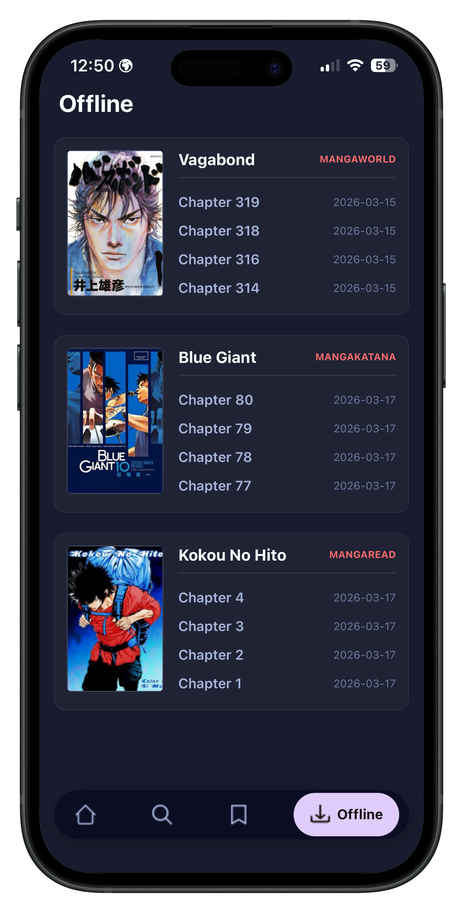

*Read this in other languages: [Italiano](README-it.md).*

# MangaBase

MangaBase is a React Native application built with Expo designed for tracking and reading content from various online sources. It acts as a specialized browser, allowing users to aggregate content, manage a personal library, and enable offline reading.

## Features

* **Multi-Source Architecture:** Modular system designed to support multiple content provider modules.
* **Offline Reading:** Download complete chapters locally to the device using the file system for reading without an internet connection.
* **Library Management:** Save favorite manga and automatically track reading progress and last read chapters.
* **Local Database:** Library, reading progress and downloads are stored in a local SQLite database. Data saved by previous versions is migrated automatically on the first launch.
* **Discover Section:** Integration with the AniList API to fetch and display top ongoing and all-time popular manga.
* **Custom Reader:** Built-in image reader with dynamic image resizing and pre-fetching capabilities for smooth scrolling.

## Project Structure

* `/src/api/` - Contains the SourceManager, DownloadManager, and a `sourceTemplate.md` blueprint explaining the required structure for implementing custom content provider modules. It also holds the shared HTTP client (http/), the SQLite connection and migration (db/), the download logic (downloads/) and the library and reading progress storage.
* `/src/app/` - Expo Router screens (Tabs, Reader, Details, Terms of Service).
* `/src/components/` - Reusable UI components like MangaCard and SearchBar, plus the building blocks of the details (details/) and reader (reader/) screens.
* `/src/errors/` - Custom error classes and global error handling UI.
* `/assets/` - Static assets, app icons, and splash screens.

## Screenshots
<p align="center">
  
  
  
</p>


## Local Development

To run this project locally on your machine for development purposes, follow these steps:

1. Make sure you are using Node.js 22.13 or newer (required by Expo SDK 58).

2. Clone the repository:
```bash
git clone https://github.com/Valerio-capl/MangaBase.git
cd mangabase
```

3. Install the dependencies:
```bash
npm install
```

4. Configure Source Modules:

To fetch content, you must implement your own source provider modules inside the /src/api/ directory (refer to sourceTemplate.md inside that folder for the required architecture and functions). Actual provider implementation files are ignored by git in the public repository for modularity and personal configuration.

5. Start the Expo development server:
```bash
npx expo start
```

From there, you can open the app using the Expo Go app on your physical device, or run it on an iOS Simulator or Android Emulator.

## Disclaimer
This application is a specialized web browser. It does not host, store, or distribute any of the manga, images, or content displayed within it. All content is dynamically fetched from third-party websites publicly available on the internet.

All manga, characters, and trademarks belong to their respective copyright owners and creators. This project is created for educational and personal use purposes.